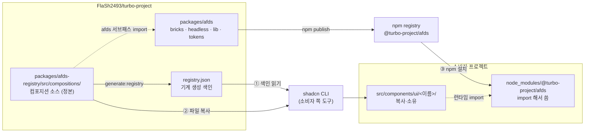

# afds-registry — AFDS 컴포지션 레지스트리

AFDS 기초 컴포넌트를 조합한 **비즈니스 UI 컴포지션**을 모아 두고, 표준 `shadcn` CLI 로
소비처에 **소스를 복사**하는 레지스트리입니다. 받은 쪽이 코드를 소유하고 자유롭게 고칩니다.

- **npm 으로 배포하지 않습니다** (`private: true`). 실체는 `src/compositions/` 디렉터리이고,
  저장소 루트 `registry.json` 이 그 색인입니다.
- 색인은 **기계 생성**됩니다. 손으로 고치지 마세요 — CI 가 재생성 결과와 대조합니다.
- 자체 CLI 는 제거됐습니다. 소비는 표준 `shadcn` CLI 하나로 합니다.

### 이름

디렉터리(`packages/afds-registry`) · `registry.json` 의 `name`(`afds-registry`) ·
`package.json` 의 `name`(`@turbo-project/afds-registry`) 이 같은 이름을 씁니다.
**`pnpm --filter` 에는 패키지 이름 `@turbo-project/afds-registry` 를 씁니다.**

## 아키텍처



저장소가 비공개라면 `①②` 에 GitHub 저장소 읽기 자격증명이 필요합니다 — 아래 「설치」 참고.

<!-- 그림을 mermaid 로 두는 이유: 텍스트라서 구조가 바뀌면 diff 에 드러납니다.
     PNG·SVG 를 커밋하면 그림과 코드가 갈라지고 그것을 잡을 검사가 없습니다. -->

## 설치 (소비자)

### 사전 준비 — 저장소 읽기 권한

저장소가 비공개라면 `registry.json` · 컴포지션 소스를 읽을 GitHub 자격증명이 필요합니다 —
`gh auth login` 또는 `GH_TOKEN`/`GITHUB_TOKEN` (`GH_TOKEN` 우선).
`@turbo-project/afds` · `lucide-react` 등 npm 의존성은 일반 npm 레지스트리에서 설치됩니다.
CLI 는 의존성 설치를 **파일 쓰기보다 먼저** 하므로, 설치가 실패하면 `src/components` 디렉터리
자체가 생기지 않습니다(실측).

소비처에 `components.json` 도 있어야 합니다 — 없으면 `add` 가 되묻고 비대화형에서는
아무것도 설치하지 않습니다(**종료코드는 0 입니다** — 아래 「주의사항」 참고).
`npx shadcn@4.19.1 init` 으로 만드는데, **전제 세 가지가 먼저 갖춰져 있어야 합니다.**

### `shadcn init` 의 전제 세 가지

`init` 은 프로젝트를 검사하고 하나라도 어긋나면 멈춥니다(실측 출력):

```
맨몸 React+TS   → ✖ Verifying framework. We could not detect a supported framework
Vite React+TS   → ✖ Validating Tailwind CSS.   ✖ Validating import alias.
```

| 전제                | 무엇이 필요한가                                                                                       |
| ------------------- | ----------------------------------------------------------------------------------------------------- |
| **지원 프레임워크** | `next` · `start` · `vite` · `react-router` · `laravel` · `astro` 중 하나. Vite 면 `-t vite`           |
| **Tailwind CSS**    | Tailwind **v4**. `init` 이 대신 설치해 주지 않습니다 — 아래 명령을 먼저 실행하세요                    |
| **import alias**    | tsconfig `paths` — `tsconfig.json` 과 `tsconfig.app.json` **양쪽** + `vite.config.ts` `resolve.alias` |

Vite 프로젝트 기준으로 두 전제를 갖추는 전체 명령입니다(`shadcn@4.19.1` · `tailwindcss@4` 실측 · v3 의 `tailwind.config.js`·PostCSS 설정은 쓰지 않습니다):

```bash
npm i -D tailwindcss @tailwindcss/vite
```

```css
/* src/index.css — 첫 줄 */
@import 'tailwindcss';
```

```ts
// vite.config.ts
import path from 'path'
import react from '@vitejs/plugin-react'
import tailwindcss from '@tailwindcss/vite'
import { defineConfig } from 'vite'

export default defineConfig({
  plugins: [react(), tailwindcss()],
  resolve: { alias: { '@': path.resolve(__dirname, './src') } },
})
```

```jsonc
// tsconfig.json 과 tsconfig.app.json 에 **각각** 넣습니다 — 이유는 아래 표
"paths": { "@/*": ["./src/*"] }
```

> `baseUrl` 은 쓰지 마세요 — TypeScript 6 에서 `error TS5101` 로 거부됩니다. `paths` 만 씁니다.

#### ⚠️ `paths` 를 한쪽에만 두면 조용히 어긋납니다

두 파일이 **서로 다른 일**을 합니다. 한쪽만 있으면 실패가 서로 다른 모습으로 나타나고,
**한쪽은 종료코드 0 입니다.**

| `paths` 위치             | `init`·`add` 의 파일 배치                            | `tsc -b`                    |
| ------------------------ | ---------------------------------------------------- | --------------------------- |
| `tsconfig.app.json` 에만 | **`./@/components/ui/...` 리터럴 디렉터리** (EXIT=0) | —                           |
| `tsconfig.json` 에만     | `src/` 정상                                          | **`TS2307` 모듈 해소 실패** |
| **양쪽**                 | `src/` 정상                                          | 통과                        |

앞의 경우가 위험합니다 — `init` 이 `✔ Validating import alias` 로 **통과시키고**
`Project initialization completed.` 까지 찍은 뒤, 파일을 이름이 `@` 인 디렉터리에 씁니다.
shadcn 은 별칭을 **검증할 때는 `tsconfig.app.json`** 을 읽고 **파일을 쓸 때는 루트
`tsconfig.json`** 을 읽는데, Vite 의 루트 `tsconfig.json` 은 `files: []` + `references` 만
담은 껍데기라 거기 `paths` 가 없으면 `@/` 가 글자 그대로 경로가 됩니다.

#### ⚠️ `moduleResolution` 이 `node` 면 AFDS 서브패스가 해소되지 않습니다

같은 `TS2307` 이 **다른 원인**으로도 납니다. AFDS 는 `@turbo-project/afds/bricks` 같은 서브패스를
`package.json` 의 `exports` 로만 제공합니다(`typesVersions` 없음). **classic `node` 해소는
`exports` 를 읽지 않고** 패키지 루트에서 `bricks/` 디렉터리를 찾는데, 배포물은 `dist` · `tokens`
· `src` 뿐이라 그런 디렉터리가 없습니다.

| 소비처 `moduleResolution`         | `@turbo-project/afds/bricks`   |
| --------------------------------- | ------------------------------ |
| `bundler` · `node16` · `nodenext` | 해소됨 (`exports` 를 읽습니다) |
| `node` (classic)                  | **`TS2307`**                   |

`bundler` 로 바꾸는 것이 정공법이지만 **기존 코드에서 오류가 한꺼번에 드러날 수 있습니다.**
그때는 `paths` 로 우회합니다:

```jsonc
// tsconfig.json — compilerOptions.paths
"@turbo-project/afds/*": ["./node_modules/@turbo-project/afds/dist/*"],
"@turbo-project/afds": ["./node_modules/@turbo-project/afds/dist/index.d.ts"]
```

`init` 이 묻는 것은 스타일·테마가 아니라 **템플릿(`-t`) · 컴포넌트 라이브러리(`-b`) ·
프리셋(`-p`)** 입니다. **셋을 다 주면 비대화형으로 끝납니다.**

```bash
npx shadcn@4.19.1 init -t vite -b base -p nova
```

아래 값은 **`shadcn@4.19.1` 실측**입니다. `-t`·`-b` 는 `--help` 에 값이 적혀 있지만
**`-p` 는 `--help` 에 목록이 없습니다** — 없는 값을 한 번 주면 CLI 가 목록을 알려줍니다
(비대화형에서도 됩니다). 다른 버전에서는 이렇게 확인하세요:

```bash
$ npx shadcn@<버전> init -t vite -b base -p '?'
Invalid preset: ?. Available presets: nova, vega, maia, lyra, mira, luma, sera, rhea
```

| 플래그 | 값                                                                    |
| ------ | --------------------------------------------------------------------- |
| `-t`   | `next` · `start` · `vite` · `react-router` · `laravel` · `astro`      |
| `-b`   | `base` · `radix` · `aria`                                             |
| `-p`   | `nova` · `vega` · `maia` · `lyra` · `mira` · `luma` · `sera` · `rhea` |

> `-t` 만 주면 **여전히 대화형**입니다(컴포넌트 라이브러리를 되묻습니다). 비대화형 환경에서는
> 되묻는 지점에서 **아무것도 하지 않고 종료코드 0** 으로 끝납니다.
>
> `--help` 는 `--defaults` 를 `--preset=base-nova` 로 설명하지만 그 값을 `-p` 에 주면
> `Invalid preset` 입니다 — CLI 자체의 불일치이니 위 표의 값을 쓰세요.

> CI 의 기본 `secrets.GITHUB_TOKEN` 은 **그 워크플로가 도는 저장소에만** 유효합니다.
> 다른 저장소에서 이 저장소를 읽는 데는 쓸 수 없습니다.

### 탐색·설치

```bash
npx shadcn@4.19.1 search FlaSh2493/turbo-project
npx shadcn@4.19.1 search FlaSh2493/turbo-project -q modal

npx shadcn@4.19.1 add FlaSh2493/turbo-project/base-table#main
```

- **ref** 는 브랜치·태그·**전체 40자 커밋 SHA**. 짧은 SHA 는 거부됩니다
  (`Could not resolve GitHub ref`). ref 는 커밋 SHA 로 해석돼 고정되므로 설치 중 브랜치가
  움직여도 파일이 섞이지 않습니다.
  - **릴리스 태그로 고정할 수 있습니다.** 태그 이름에 `@` 와 `/` 가 들어가도 그대로 씁니다 —
    `FlaSh2493/turbo-project/base-table#@turbo-project/afds@<버전>` 처럼(버전은 아래 태그 조회로
    확인합니다). 그러면 그 릴리스 시점의
    `registry.json` 이 쓰이고 설치된 아이템의 AFDS 기준 버전도 그 태그의 값이 됩니다.
  - **`registry.json` 이 모든 ref 에 있는 것은 아닙니다.** `main` 과 그 뒤로 갈라진 브랜치에는
    있고, **태그 중에서는** 그 파일이 도입된 뒤의 릴리스 태그에만 있습니다. 특정 ref 에
    있는지는 이렇게 확인합니다:

    ```bash
    gh api "repos/FlaSh2493/turbo-project/contents/registry.json?ref=<ref>" --jq .size
    ```

  - 쓸 수 있는 ref 는 `gh api repos/FlaSh2493/turbo-project/tags` · `gh api repos/FlaSh2493/turbo-project/branches`
    로 확인합니다. **없는 ref 를 쓰면 인증·네트워크 오류처럼 보이는 메시지가 나오지만**, 원인은
    대개 "그 ref 에 `registry.json` 이 없다" 입니다.

- **형제 컴포지션이 함께 옵니다.** 예: `range-filter` 를 받으면 `base-input` 도 같이
  설치됩니다. 무엇이 함께 오는지는 **설치 전에** 확인할 수 있습니다:

  ```bash
  npx shadcn@4.19.1 view FlaSh2493/turbo-project/range-filter#main
  ```

  아이템의 `meta.bundledCompositions` 와 `files[]` 가 그대로 나옵니다.

- **설치 직후 AFDS 기준 버전 안내가 출력됩니다.** 그 값은 "최소 요구 버전" 이 아니라
  "이 버전으로 생성·검증됐다" 입니다.

## 유지보수 — 컴포지션 등록

```bash
# 1. 디렉터리 (kebab-case) + index.ts + <이름>.spec.md
# 2. 색인 재생성
pnpm --filter @turbo-project/afds-registry generate:registry
# 3. PR → main 머지 = 배포
```

**Claude Code 에서 `/composition-new` 로 이 과정을 대화형으로 진행할 수 있습니다** — Figma 링크·레퍼런스
URL·캡처 이미지를 주면 파일 생성 · 검사 · Storybook 확인 · PR 까지 합니다. 디자이너용으로 만들었고,
절차 정본은 `.claude/skills/composition-new/SKILL.md` 입니다.

처음 쓰는 디자이너는 [PD 온보딩 안내](../../.claude/skills/composition-new/onboarding.html)를 먼저 보세요 —
저장소 루트에서 `open .claude/skills/composition-new/onboarding.html` 로 브라우저에서 엽니다(GitHub 에서는 소스로 보입니다).
`/composition-new` 도 시작할 때 이 페이지를 띄웁니다.

`*.spec.md` 의 **H1 다음 인용 블록(`> …`)이 아이템 `description` 으로 기계 추출**됩니다.
없으면 생성이 실패합니다. 파일 작성 규칙·의존성 도출·override 는 [GUIDE](./docs/GUIDE.md) 참고.

### 통과해야 하는 검사

| 검사                                    | 무엇을 막나                                                                                       |
| --------------------------------------- | ------------------------------------------------------------------------------------------------- |
| 정합 (`generate:registry` + `git diff`) | 재생성하지 않은 낡은 색인                                                                         |
| `validate:registry`                     | shadcn 규격 위반 · `files[]` 의 파일 부재                                                         |
| closure 가드                            | 아이템↔디렉터리 불일치 · 전이 폐쇄 누락 · 의존성 미선언 · `docs` 누락                             |
| `build-registry` 가드                   | AFDS 루트 배럴 import · 치환 규칙 없는 상대 import · `exports` 미선언 서브패스 · `*.spec.md` 누락 |
| `eslint` · `check-types`                | 코드 품질 · 타입                                                                                  |
| 스토리 결정성 · 래핑 계약               | 비결정적 스토리 · 래핑 규약 위반                                                                  |

## 주의사항

- **AFDS 루트 배럴과 서브패스를 섞지 마세요.** Module Federation 에서 AFDS 인스턴스가
  갈라집니다. 컴포지션은 서브패스만 씁니다(`@turbo-project/afds/bricks`). 생성 가드가 막습니다.
- **`shadcn add --overwrite` 는 소비자가 고친 코드를 경고 없이 덮습니다.** 옵션 없이 쓰면
  파일마다 묻고, 비대화형에서는 덮지 않습니다. **`--yes` 도 덮지 않습니다** — 프롬프트를
  건너뛸 뿐이고 기존 파일은 보존됩니다. 재설치 전에는 `--diff` 로 먼저 보세요.
- **이미 선언된 의존성의 버전은 바뀌지 않습니다.** `add` 는 없는 의존성만 추가하고, 소비처
  `package.json` 에 이미 있는 항목의 범위는 그대로 둡니다(정확 핀도 유지됩니다).
- **`cn` 유틸은 스캐폴드되지 않습니다.** shadcn 이 보통 만들어 주는 `lib/utils.ts` 가
  생기지 않습니다 — AFDS 가 `@turbo-project/afds/lib/utils` 로 제공하고 컴포지션이 그것을
  import 하기 때문입니다. 소비처에 같은 이름의 파일이 없어도 정상입니다.
- **★ 아무 일도 하지 않고 종료코드 0 을 내는 경우가 셋 있습니다** — CI 에서 종료코드로만
  판정하면 세 경우 모두 "성공" 으로 읽힙니다. 파일이 실제로 생겼는지 확인하세요.

  | 상황                          | 실제 결과              | 종료코드 |
  | ----------------------------- | ---------------------- | -------- |
  | `init` 을 stdin 닫힌 채 실행  | `components.json` 없음 | **0**    |
  | `components.json` 없이 `add`  | 파일 0개               | **0**    |
  | `--overwrite` 없이 다시 `add` | 덮지 않음              | **0**    |

- **`--diff` 는 경로를 주지 않으면 처음 5개 파일만 봅니다**(`Showing 5 of N files.`).
  6번째 이후가 달라져 있어도 앞 5개를 "No changes" 로 찍고 끝나므로 **실제 드리프트를
  가립니다.** 파일 수가 5를 넘는 아이템은 `--diff <파일경로>` 로 하나씩 보세요.
  (`shadcn diff` 명령 자체는 DEPRECATED 입니다 — `add <item> --diff` 를 씁니다.)
- **등록 게이트는 PR 리뷰입니다.** 승인 정본이 제거돼, 디렉터리를 만들고 위 검사만 통과하면
  색인에 편입됩니다.
- 아직 기계가 막지 않는 것: #160 ·
  #161 ·
  #162.

## 더 보기

- [GUIDE](./docs/GUIDE.md) — 컴포지션 작성 규칙 · 의존성 도출 · 프로젝트 구조 · 검증 절차
- 이름공간(`@afds-registry/...`) 표기, 레지스트리 파일 분리(`include`) 등 **지금 쓰지 않는
  선택지**와 그 근거도 GUIDE 에 있습니다.
